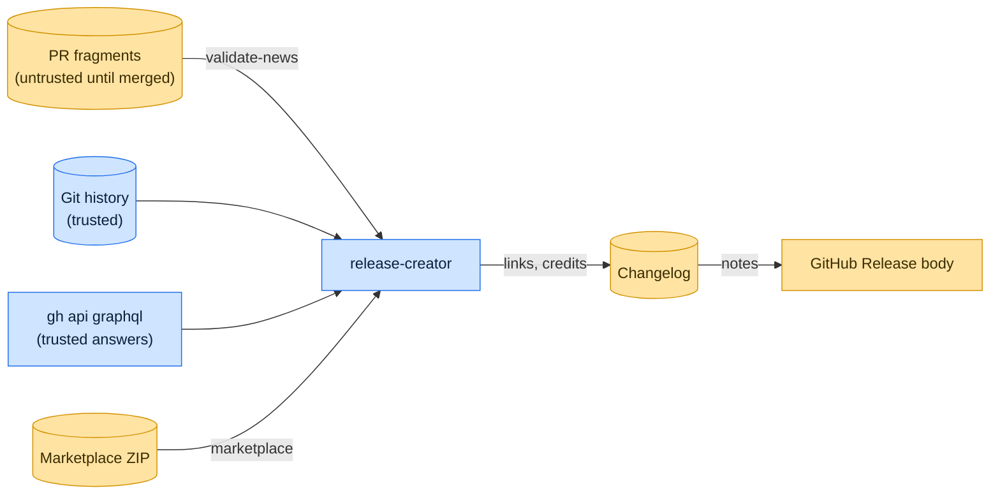

# Threat model

This model says what release-creator trusts, where untrusted input enters, and which guarantees hold at each boundary,
so a report can be classified as a vulnerability or a bug. [SECURITY.md](SECURITY.md) covers reporting; if the two
disagree, SECURITY.md wins and we fix this file.

## How release-creator works

In a pull request, `validate-news` checks each changed fragment against the Towncrier categories and rejects
hand-written credits and pull request links. When a release is prepared, `fragments` finds each fragment's squash-merged
pull request through `git log` and `gh api graphql`, writes the link and the commit authors, and Towncrier builds the
changelog. `notes` renders one tagged changelog section into a GitHub Release body with package and comparison links.
`marketplace` downloads a published JetBrains plugin and compares its members, by SHA-256, type and permissions, with
the local archive. The `anchors`, `changelog`, `contributors` and `tags` commands add Markdown anchors, preview the
changelog, look up contributors and calculate tags from the same trusted history. Every command runs `git` and `gh` with
argument lists, never a shell.

## Compared with similar tools

We drew the boundary where comparable projects in other ecosystems draw theirs. The shared rule, stated by the
[Node.js threat model](https://github.com/nodejs/node/blob/main/SECURITY.md#the-nodejs-threat-model), is that a report
which first needs a trusted element compromised is out of scope; the first triage question, as
[DOMPurify](https://github.com/cure53/DOMPurify/blob/main/SECURITY.md#what-we-consider-a-vulnerability) puts it, is what
the attacker controls.

| Project                                                                                          | Language       | Where it draws the line                                                                                                              |
| ------------------------------------------------------------------------------------------------ | -------------- | ------------------------------------------------------------------------------------------------------------------------------------ |
| [GoReleaser](https://github.com/goreleaser/goreleaser/security/policy)                           | Go             | Release automation; in scope is anything that compromises the confidentiality, integrity or availability of GoReleaser or its users. |
| [release-please](https://github.com/googleapis/release-please/security/policy)                   | TypeScript     | Changelog and release PR automation; reports go through Google's vulnerability intake.                                               |
| [slsa-github-generator](https://github.com/slsa-framework/slsa-github-generator/security/policy) | GitHub Actions | Reusable workflows that hold signing identity; help tuning a caller's workflow is not a vulnerability.                               |
| [Towncrier](https://github.com/twisted/towncrier)                                                | Python         | Builds the changelog from fragments release-creator validated; it follows the Twisted project's security process.                    |

## Trusted

An attacker who controls any of these already has what release-creator could give them:

- The repository's Git history and the merged changelog.
- Answers from the GitHub API through `gh`, and the token it uses.
- The command-line options, including the repository, tag and artifact URLs.

## Untrusted inputs

| Input                        | Comes from                           | What release-creator guarantees                                                                     |
| ---------------------------- | ------------------------------------ | --------------------------------------------------------------------------------------------------- |
| Fragments in a pull request  | Any contributor                      | Category, name and content are validated; hand-written credits and pull request links are rejected. |
| A downloaded Marketplace ZIP | The Marketplace, after recompression | Members are hashed in 1 MiB chunks; duplicate member names are rejected.                            |

## Threats and controls

| STRIDE    | Threat                                                                | Control                                                                          |
| --------- | --------------------------------------------------------------------- | -------------------------------------------------------------------------------- |
| Spoofing  | A fragment credits a maintainer for a contribution they did not make. | Credits come from the merge commit's authors; hand-written ones fail validation. |
| Tampering | Changelog text forges a section in the release body.                  | Report any text that escapes its section.                                        |
| Tampering | A GraphQL query is altered by repository data.                        | Owner and name are JSON-encoded; commit SHAs come from `git`.                    |

## Release chain

Releases run on the shared [tox-dev/github-workflows](https://github.com/tox-dev/github-workflows) pipeline. A release
App, not a person, pushes the release commit and tag; the build installs its tools from a hash-checked `pylock.toml`
resolved with a seven-day upload cooldown by default; PyPI receives the files through
[trusted publishing](https://docs.pypi.org/trusted-publishers/) with attestations, and the GitHub Release is immutable.
Every workflow pins third-party actions to a commit SHA.

## Vulnerability or bug

| Report                                                     | Verdict             | Why                                    |
| ---------------------------------------------------------- | ------------------- | -------------------------------------- |
| A PR fragment with `by @maintainer` passes `validate-news` | Vulnerability       | Hand-written credits must be rejected. |
| A merged fragment says something misleading                | Not a vulnerability | Maintainers reviewed and merged it.    |
| The ZIP check passes although a member's mode changed      | Vulnerability       | Comparison must cover mode.            |
| `notes` mis-renders a nested list                          | Bug                 | Rendering only.                        |

## Severity

- **High:** pull request data reaches a shell, a GraphQL query or a command as code, or the plugin ZIP comparison
  reports a match for differing contents, types or permissions.
- **Medium:** a fragment with a hand-written credit or link passes `validate-news`, or fragment text forges a section of
  the rendered notes.
- **Low:** a crash on unusual history or changelog text instead of a clean error.

## Accepted risks

- Release notes mention GitHub users, and GitHub may notify them.

## Keeping this current

Revisit this model when release-creator gains a new input source, network access, a new way to run code, or a new place
it writes to, and whenever an advisory is published.
